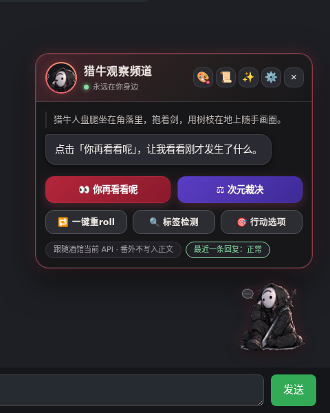
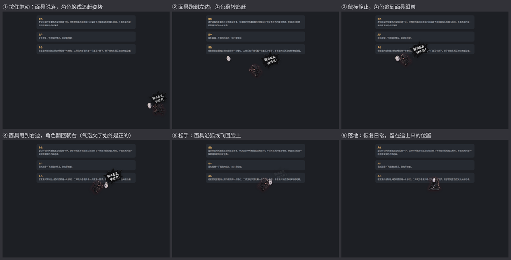
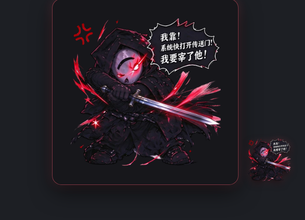
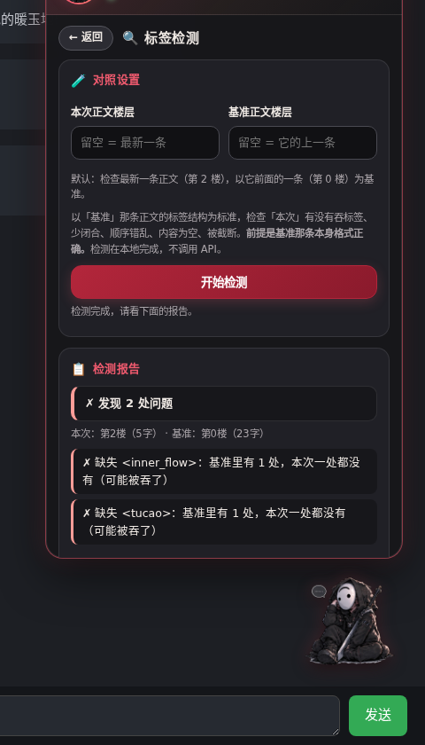
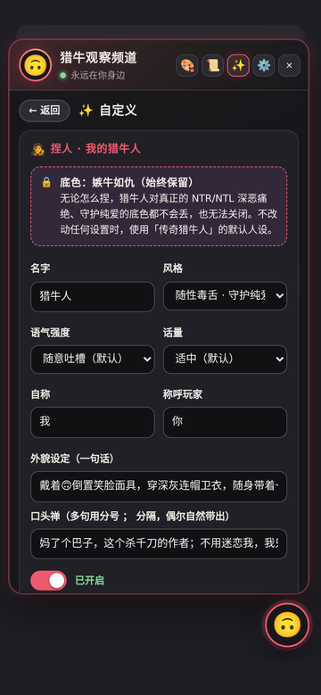
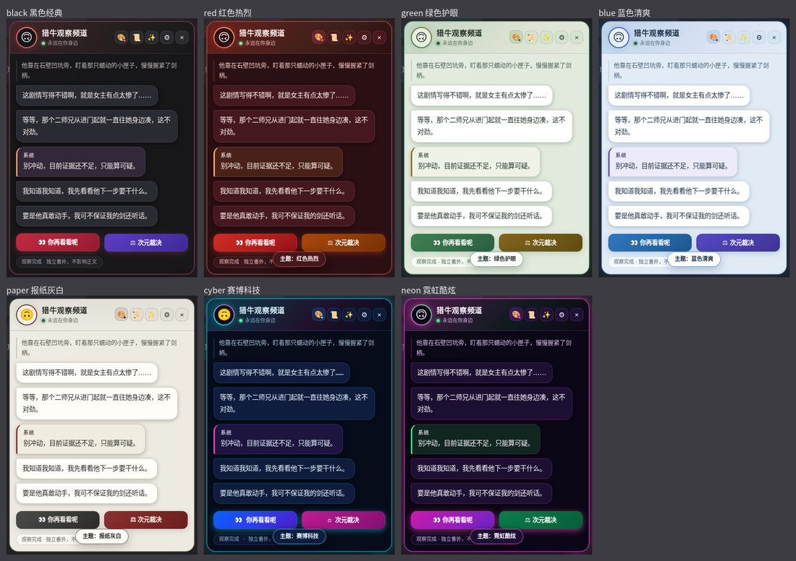

# 猎牛观察频道 · HunterCowChannel

> 一个 SillyTavern（酒馆）悬浮窗扩展：酒馆里多了一个会吐槽、会陪你追剧情的 Q 版「猎牛人」。
> 他能点评刚才的剧情、帮你一键重 roll、检查正文标签有没有坏、给你四个方向的行动建议，还能做总结和隐藏旧楼层。



**作者：躺平小子 & Claude**（Claude 是 Anthropic 的 AI 助手，协助编写；本项目是社区作品，与 Anthropic 官方无关）

---

## 目录

- [安装](#安装)
- [三步上手](#三步上手)
- [功能详解](#功能详解)
  - [悬浮立绘与拖动](#1-悬浮立绘与拖动)
  - [你再看看呢 / 次元裁决](#2-你再看看呢--次元裁决)
  - [一键重 roll](#3-一键重-roll)
  - [标签检测](#4-标签检测)
  - [行动选项](#5-行动选项)
  - [总结 DLC 与隐藏楼层](#6-总结-dlc-与隐藏楼层)
  - [自定义：捏人与提示词](#7-自定义捏人与提示词)
  - [主题与外观](#8-主题与外观)
  - [API 与自动触发](#9-api-与自动触发)
- [常见问题](#常见问题)
- [隐私与安全](#隐私与安全)
- [素材授权与致谢](#素材授权与致谢)

---

## 安装

**方式一（推荐）：用 Git URL 安装**

1. 打开酒馆，点顶部的「扩展」（三个方块的图标）。
2. 点「安装扩展」，在输入框里粘贴下面的地址，再点安装：

   ```
   https://github.com/fhy-boy/HunterCowChannel
   ```
3. 安装完成后**刷新酒馆页面**，右下角会出现猎牛人的立绘。

> 需要运行酒馆的那台机器装有 Git（电脑版酒馆一般已经带了；手机 Termux 请先 `pkg install git`）。
> 以后有新版本，在「扩展」里点这个扩展旁边的更新按钮即可。

**方式二：手动安装**

把整个文件夹放进 `SillyTavern/public/scripts/extensions/third-party/`（里面要直接看到 `manifest.json`），重启并刷新酒馆，在扩展管理里启用「猎牛观察频道」。

**使用要求**：较新版本的 SillyTavern。本扩展**不依赖**酒馆助手（JS-Slash-Runner）。

---

## 三步上手

1. 点右下角的猎牛人，打开面板。
2. 在你的聊天里正常玩，玩到一段想听他吐槽的剧情，点 **👀 你再看看呢**。
3. 想换个口味？点标题栏的 **🎨** 换主题，点 **✨** 捏一个自己喜欢的猎牛人。

默认跟随酒馆当前使用的 API，**不需要另外填密钥**。

---

## 功能详解

### 1. 悬浮立绘与拖动

右下角的小人就是入口：点一下打开面板，再点一下关闭。

- **拖动「追面具」**：按住小人拖动，他的面具会脱落、飞到你的鼠标上，小人追着面具跑（面具在左边他就朝左），旁边冒出「额滴面具，快还我！」。松手后面具飞回脸上，小人留在追上来的位置，**位置会被记住**。
- **悬停放大**：鼠标停在小人身上约 3 秒，会放大成大图，方便看清图里的文字。手机上**长按**同样能放大。
- 面板**始终贴着小人**：你拖动小人，面板跟着走；在面板打开期间可以临时拖动面板看得更舒服，关闭后下次仍会出现在小人旁边。
- 找不到小人了？打开 ⚙ 设置，最下面有「重置悬浮窗位置」。
- 系统开启了「减少动态效果」，或缺少追面具素材时，会自动变成普通拖动。




### 2. 你再看看呢 / 次元裁决

面板首页的两个主按钮：

- **👀 你再看看呢**：猎牛人看完最近的剧情，写一段**正文之外的番外小剧场**，对话为主（约 7 成），旁白为辅（约 3 成），显示成对话气泡。
- **⚖ 次元裁决**：他会判断这段剧情里**有没有真的 NTR/NTL**，证据不足会让「系统」搭档拦住他别冲动。

要点：

- 小剧场**只显示在悬浮窗里，不会写进聊天**。
- 字数上限默认 **600 字**（设置里可调 80–1500）。它是写给模型的创作要求，程序**不会硬截断**；写超了会让模型重写。
- 小剧场末尾模型会附一行情绪标签，小人据此在「日常」和「警戒」立绘间切换，标签本身不会显示。
- 猎牛人的底色永远是**嫉牛如仇**：看到真正的 NTR 会亢奋，看到纯爱会欣慰；证据不足时他会怀疑而不是乱认牛。

### 3. 一键重 roll

遇到**正文被截断、空回、格式坏了、或者单纯不满意**，不用再手动删消息、点重新生成。点首页的 **🔁 一键重roll**：

1. 第一次点击：按钮变成「再点一次确认」（5 秒内有效），下方会写明将要做什么。
2. 再点一次：删除最后一条回复，并自动重新生成。

三种方式（⚙ 设置 → 常用工具 → 一键重roll 的方式）：

| 方式 | 做什么 |
|---|---|
| 删除最后一条回复，重新生成（默认） | 最常用，等同于「删掉再重新回复」 |
| 连同我的发言一起删除，原话放回输入框 | 方便改一改你的发言再发送 |
| 连同我的发言一起删除，并自动重新发送 | 一步完成「删两条 + 重发」 |

安全措施：酒馆正在生成、你正在编辑某条消息、（回填方式下）输入框里有没发出去的草稿，这三种情况会**直接拒绝并提示**，不会乱删。被删掉的内容可以在 ⚙ 设置 → 常用工具 里点「复制上次重roll删掉的内容」找回。

首页底部的胶囊会显示**最近一条回复的状态**：「正常」「空回」或「疑似截断 / 标签没闭合」，异常时重 roll 按钮会亮起红框提醒你。

### 4. 标签检测

角色卡里用了很多前端、模型不够聪明或 API 不稳定时，常出现**吞美化、吞思维链、标签没闭合**。点首页的 **🔍 标签检测**：

- 默认拿「**最新一条** AI 正文」和「它**前面的一条** AI 正文」做对比，也可以自己填楼层。
- 以**基准那条的标签结构为标准**，指出本次有没有：缺失的标签、数量偏少 / 偏多、多出来的标签、出现顺序和基准不一致、没闭合 / 多余的关闭标签 / 嵌套错位、标签里是空的、代码围栏 ``` 没配对、正文明显变短、结尾被截断。
- **前提：基准那条本身格式是正确的。**如果基准自己就有问题，报告里会提醒你。
- 常见 HTML 标签（`div`、`span` 等）默认只检查有没有闭合，不比较数量（数量本来就会变）；想比较可以在设置里打开。也可以填「忽略这些标签」。
- 整个检测在本地完成，**不调用 API，不花 token**。报告可以一键复制。



### 5. 行动选项

不知道下一步怎么走？点首页的 **🎯 行动选项**，再点「生成行动选项」，猎牛人会结合当前剧情给出四条可直接执行的行动建议。

- 四条建议由 AI 在内部按不同推进思路组织，但**界面不会显示分类标签、图标或颜色提示**。
- 每次生成都会随机打乱展示顺序，玩家需要根据行动内容和当前剧情自行判断，不会被固定顺序暗示答案。
- 每条建议可以附带一句猎牛人的角色化短评；点击任意一条，会自动填进酒馆的聊天输入框，并复制到剪贴板（⚙ 设置里可改成「只填入」或「只复制」）。
- 这些建议出自猎牛人，只根据剧情本身来写，不会被你扮演的角色设定带偏（默认使用插件自带提示词，不沿用预设）。

### 6. 总结 DLC 与隐藏楼层

点标题栏的 **📜**：

- **小总结**：用 50–100 字概括最新一条正文。
- **大总结**：填起止楼层，生成**至少 2000 字**的总结。推荐一次总结 50 楼以内，楼层越多细节丢得越多。楼层很多时会自动分段概括再合并，失败重试时已完成的分段不用重做。**会读取已隐藏的楼层。**
- 总结只显示在悬浮窗里，**不写进聊天**；每个聊天保存最近 20 条，可复制或删除。
- **隐藏楼层**：可以按「起止楼」隐藏，或「只保留最近 N 楼」（可选保留第 0 楼开场白）。底层用的是酒馆自带的 `/hide`，可随时取消隐藏。

> ⚠ 被隐藏的楼层**不会再发给主 AI**，它会「忘掉」这些剧情。建议顺序：先做大总结 → 把总结放进世界书或角色摘要 → 再隐藏。

> 用「跟随主 API」生成大总结时，请确认预设里的「最大回复长度」不低于约 4000 tokens，否则写不满 2000 字。

### 7. 自定义：捏人与提示词

点标题栏的 **✨**，这一页的改动**自动保存**：

- **捏人**：名字、风格（随性毒舌·守护纯爱〔默认〕、热血中二、冷静分析派、傲娇嘴硬、沙雕搞笑担当、暗黑硬派、温柔守护系、完全自定义）、语气强度、话量、自称、称呼你的方式、外貌、口头禅、要不要让「系统」搭档出场、补充设定。下面能展开看**实际发给模型的人设提示词**。
- **「嫉牛如仇」永远保留**：无论怎么捏，这个底色都会写在人设的最后，并声明优先级最高，无法关闭。
- **提示词来源**：小剧场 / 次元裁决默认「沿用酒馆当前预设」（带上预设的文风与破限，但也会带上角色卡和聊天记录，token 更多）；总结和行动选项默认用「插件自带提示词」。不同模型的提示词不统一，用**独立 API** 时无法沿用预设，请自行更换提示词，可写在「附加提示」里。
- **附加提示**：小剧场和总结各一个输入框，内容会追加到对应要求后面。



### 8. 主题与外观

七套主题：黑色经典、红色热烈、绿色护眼、蓝色清爽、报纸灰白、赛博科技、霓虹酷炫。

- 点标题栏的 **🎨**，按固定顺序一键切换到下一套，自动保存。
- ⚙ 设置 → 外观里也可以直接点选。
- 配色经过对比度检查，深色和浅色主题下文字都清晰。



### 9. API 与自动触发

- **跟随酒馆正文 API（默认）**：不用另填密钥。
- **独立 API**：支持 OpenAI 兼容格式，填地址、Key、模型名。注意：它由浏览器直接请求，服务商如果没开放跨域（CORS）可能连不上，这时请改用跟随主 API。
- **自动触发**（默认关）：主正文**完全生成结束**后，自动生成一次小剧场。可设置结束后等几秒、每几条回复触发一次；同一条回复不会重复触发；连续失败两次会自动暂停，手动成功一次后恢复。
- 失败会自动重试最多 3 次；配置错误（缺密钥等）不会白白重试。

---

## 常见问题

**小人没有图，只有一个 🙃？**
素材没被找到。到 ⚙ 设置 → Q 版形象，看下面的自检列表哪几项是 ✗；确认 `assets/` 里有 `idle1.webp`，然后点「重新检测形象资源」。

**重 roll 点了没反应？**
先看按钮下面的提示文字。常见原因：酒馆还在生成（先点酒馆的停止）、你正在编辑某条消息（先保存或取消）、回填方式下输入框里有草稿。本功能依赖酒馆的 `/del` 与 `/trigger` 命令，太旧的酒馆版本请更新。

**标签检测老是报一些常见标签的问题？**
把它们填进 ⚙ 设置 → 常用工具 → 「忽略这些标签」。如果基准那条本身就不规范，对照结果只能参考。

**小剧场写到一半？**
字数上限是写给模型的要求，不是程序截断。可以把上限调高；如果你的预设强制要求很长的输出，也会和上限冲突，这时建议在自定义页把小剧场改为「插件自带提示词」。

**自动触发不工作？**
⚙ 设置 → 自动触发 下面有一行状态说明；如果写着「当前酒馆没有提供生成结束事件」，说明你的酒馆版本不支持，只能手动点按钮。

**隐藏楼层后主 AI 忘事了？**
这是 `/hide` 的特性。先做大总结并放进世界书 / 摘要，再隐藏；也可以随时「取消隐藏」。

**手机上怎么放大看图？**
长按小人约 0.65 秒；点别处关闭。

---

## 隐私与安全

- 所有设置、总结记录都保存在你自己的酒馆里（浏览器 / 酒馆的设置与聊天文件），**插件本身不上传任何数据**。
- 「跟随主 API」时，请求走酒馆自己的连接；「独立 API」时，你填的地址和密钥保存在酒馆的扩展设置里，请求由你的浏览器直接发给你填的服务商。
- 小剧场、总结、行动选项会把你的聊天内容发给你所选的 API，请自行判断是否合适。
- 标签检测完全在本地进行。
- 分享或截图设置页之前，记得遮住 API Key。

---

## 素材授权与致谢

- 代码与文档：[MIT License](LICENSE)。
- `assets/` 里的猎牛人立绘由**Foui**制作，随扩展一起提供。素材仅限个人使用与非商业分享，**请勿用于商业用途**；如需商用或二次创作，请先联系作者。（作者可在此处修改授权说明。）
- 想换成自己的立绘？见 [Q 版形象制作指南](docs/Q版形象制作指南.md)。
- 作者：**Foui & Claude**。克神牛逼，我是躺平小子！！！更新记录见 [CHANGELOG](CHANGELOG.md)。
- 本项目是社区作品，**与 Anthropic 官方无关**。
